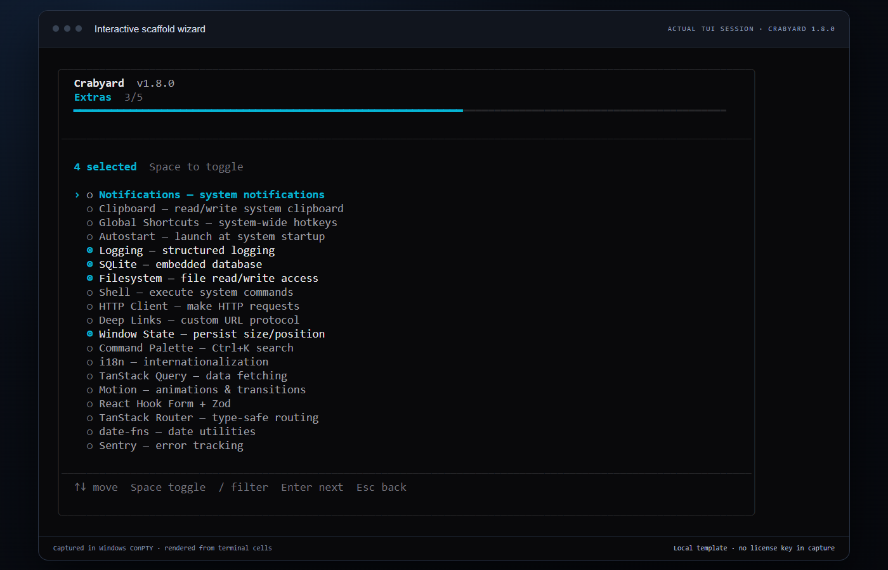

<div class="crabyard-intro" markdown>

<p class="crabyard-eyebrow">RUST + TAURI · FROM FIRST PROJECT TO FIRST RELEASE</p>

# Build with Crabyard

Generate your app, understand the foundations, and give your coding agent a clear place to start.
{ .crabyard-lead }

[Install the CLI](getting-started/installation.md){ .md-button .md-button--primary }
[Explore the commands](reference/cli.md){ .md-button }

</div>

## Find your next step {#whats-included}

<div class="grid cards crabyard-paths" markdown>

-   __Create your first app__

    Install the prerequisites, choose a preset, and run your generated desktop app.

    [Follow the quick start →](getting-started/quick-start.md)

-   __Choose your foundations__

    Configure authentication, pick your UI, and understand how the overlays fit together.

    [Authentication](guides/auth.md) · [UI choices](guides/ui.md) · [Architecture](guides/overlay-architecture.md)

-   __Build with a coding agent__

    Inspect readiness, export a focused brief, and work from shared project instructions.

    [Use check and context →](guides/ai-development.md)

-   __Prepare your release__

    Review the remaining configuration and connect signed updates for your app.

    [Configure auto-updates →](guides/auto-updates.md)

</div>

## A useful first workflow

With the CLI installed, start from a local checkout of the public templates:

```sh title="Generate · check · hand off"
git clone https://github.com/Crabyardcom/crabyard-templates.git
crabyard new "Field Notes" --template ./crabyard-templates --preset local-first --yes
crabyard check --project ./field-notes
crabyard context --project ./field-notes --brief "Add tags and search"
```

The local-template path works without a license key. Hosted template downloads require a Crabyard license. See [installation](getting-started/installation.md) for prerequisites, installer choices, and API configuration.

!!! note "Your app still has a release checklist"

    OAuth client IDs, signing keys, updater configuration, and product behavior remain yours to configure and verify. The readiness audit reports configuration gaps; run the generated app's tests and build checks as well.

<div class="crabyard-proof" markdown>

<a class="crabyard-capture" href="assets/crabyard-tui-wizard.png" target="_blank" rel="noopener noreferrer" aria-label="Open the actual Crabyard terminal wizard at full size"></a>

<div markdown>

### See what you are running

The interactive wizard helps you select the app's stack and native features. This is a real Crabyard terminal session, captured through Windows ConPTY and rendered for readability.

[Open the actual capture at full size ↗](assets/crabyard-tui-wizard.png)

[Inspect the CLI source ↗](https://github.com/Crabyardcom/crabyard-cli) · [Capture provenance](assets/crabyard-capture-provenance.json)

</div>

</div>
